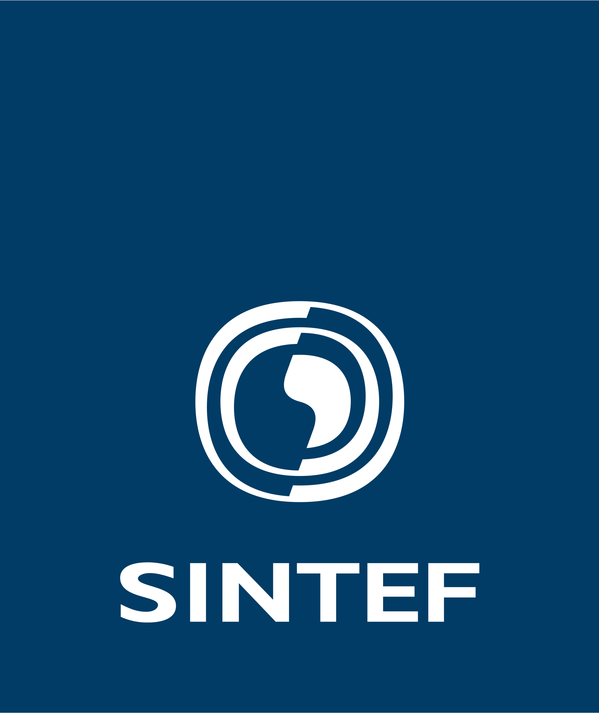
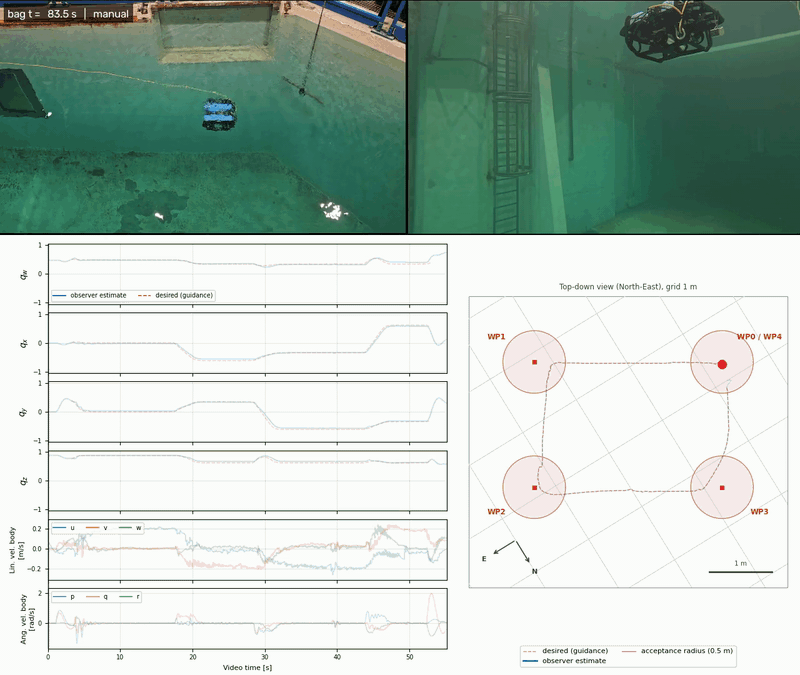
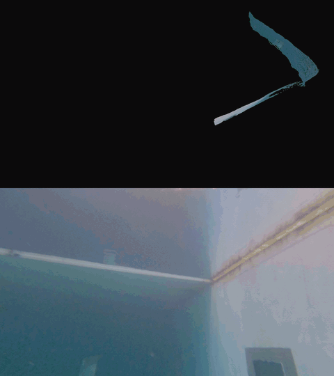

# Sim2Swim: Zero-Shot Velocity Control for Agile AUV Maneuvering in 3 Minutes

**BlueROV2 Heavy Configuration** | [Paper](https://arxiv.org/abs/2512.08656)

Sim2Swim is a learned velocity-control policy for the BlueROV2 in the heavy configuration.

| velocity and orientation tracking | agility for efficient mapping | disturbance rejection |
| :---: | :---: | :---: |
|  |  |  |

---

## Policy Input

The policy receives a 16-dimensional observation vector $\boldsymbol{o}$:

$$
\boldsymbol{o} = [q_e, v_d - v, \omega, z_v, z_q]
$$

where $q_e$ is the attitude error, $v_d$ is desired body velocity, $v$ is measured body velocity, $\omega$ is measured angular velocity, $z_v$ is the integral of velocity error, and $z_q$ is the integral of quaternion error.

The measurements used to form the input are:

- current attitude $q$
- desired attitude $q_d$
- desired body velocity $v_d$
- measured body velocity $v$
- measured angular velocity $\omega$

---

## Policy Output

The policy outputs $\boldsymbol{a}$, a wrench of PWM signals:

$$
\boldsymbol{a} = [a_x, a_y, a_z, a_{rx}, a_{ry}, a_{rz}]^T
$$

Each component of $\boldsymbol{a}$ is a PWM command between $1100$ and $1900$.

---

## ROS Interface

Topic names are configurable through [config/sim2swim.yaml](config/sim2swim.yaml).

| Direction | Parameter | Message type |
|---|---|---|
| Subscribe | `topics.desired_velocity_body` | `geometry_msgs/msg/Vector3Stamped` |
| Subscribe | `topics.desired_quaternion` | `geometry_msgs/msg/QuaternionStamped` |
| Subscribe | `topics.angular_velocity` | `geometry_msgs/msg/Vector3Stamped` |
| Subscribe | `topics.quaternion` | `geometry_msgs/msg/QuaternionStamped` |
| Subscribe | `topics.arm_status` | `std_msgs/msg/Bool` |
| Subscribe | `topics.in_auto` | `std_msgs/msg/Bool` |
| Subscribe | `topics.velocity_body` | `geometry_msgs/msg/Vector3Stamped` |
| Publish | `topics.tau_pwm` | `geometry_msgs/msg/WrenchStamped` |

---

## Usage

The node requires ROS 2, NumPy and PyTorch. From the ROS 2 workspace root, with ROS sourced:

```bash
git clone https://github.com/lrfosso/Sim2Swim.git src/sim2swim
colcon build --packages-select sim2swim
source install/setup.bash
ros2 launch sim2swim sim2swim.xml
```
---

## Citation

Please cite this work when using this policy or code in your own research or applications.

```
@article{fosso2025sim2swim,
	title={Sim2Swim: Zero-Shot Velocity Control for Agile AUV Maneuvering in 3 Minutes},
	author={Fosso, Lauritz Rismark and Amundsen, Herman Biørn and Xanthidis, Marios and Ohrem, Sveinung Johan},
	journal={arXiv preprint arXiv:2512.08656},
	year={2025},
	url={https://arxiv.org/abs/2512.08656}
}
```
